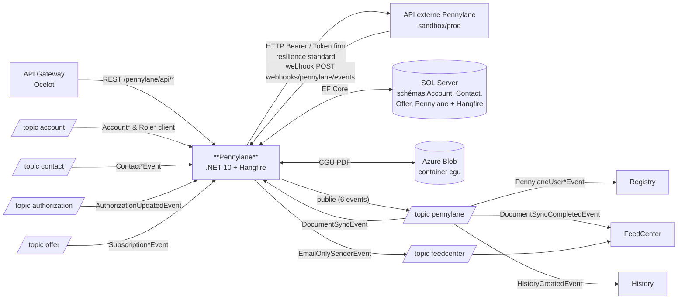

# Pulse.Back.Pennylane — Architecture & Service Context

> **Document de contexte humain / agent IA.**
> L'inventaire factuel (endpoints, events publiés/consommés, handlers, projets, packages internes)
> est porté par [`architecture.graph.yaml`](./architecture.graph.yaml), **régénéré automatiquement sur `main`**
> par la pipeline ArchGraph, et consolidé dans `pulse.graph.yaml` (topics, subscriptions, consommateurs)
> et `events.catalog.yaml` (payloads des events) côté Pulse.Architecture.Docs.
> **Ne pas dupliquer ces listes ici** — ce document porte ce que le graphe ne dit pas :
> rôle métier, invariants, points d'attention, règles spécifiques.
>
> Point d'entrée agents : [`AGENTS.md`](./AGENTS.md) (conventions) → ce fichier (contexte) → le graphe (facts).

---

## 1. Rôle du service

<!-- DRAFT: à relire par l'équipe -->

Le service **Pennylane** est le connecteur entre la plateforme Pulse et l'outil comptable **Pennylane** (SaaS externe). Il gère :

- Le **provisioning des accès** des contacts clients sur Pennylane : création d'utilisateurs, attribution/révocation de rôles (`grant_access` / `revoke_access`) au niveau company et firm, selon les rôles Pulse et les plans SaaS (`PlansRoleAssignments`)
- L'**onboarding des companies** Pennylane pour les comptes clients Pulse
- La **synchronisation des documents** comptables déposés dans le DMS Pennylane (FEC, fiscal, publications — chemins `DocumentSyncSettings.SyncPaths`) vers Pulse, avec un scheduler Hangfire quotidien et un traitement asynchrone via events
- Les **webhooks entrants** Pennylane (`user.created`, `user.updated`) republiés en events internes pour le service Registry
- La gestion des **accès signataires / avenants** (import CSV, validation, historique) et des **CGU** (PDF stockés dans Azure Blob Storage, dates de fin d'essai gratuit `FreeTrialInfo`)
- Les **emails de conformité** (acceptation/refus) et l'**email récapitulatif quotidien** des dépôts de documents (via events vers FeedCenter)
- Des **permissions GED** spécifiques Pennylane (`PennylaneGedPermissionEntity`)

C'est un service **support** (intégration tierce) : il projette localement les données Account / Contact / Offer / Authorization reçues par events.

### Vue d'ensemble des flux

> Vue synthétique **indicative** — la source de vérité de la topologie est le graphe consolidé `pulse.graph.yaml`.



---

## 2. Données possédées

| Entité | Description |
|--------|-------------|
| `AccountEntity` | Projection locale des comptes clients (source : service Account) |
| `CompanyEntity` | Company Pennylane liée à un compte Pulse (id interne Pennylane) |
| `ContactEntity` | Projection locale des contacts (source : service Contact) |
| `DocumentEntity` | Document DMS Pennylane synchronisé (métadonnées) |
| `DocumentsSyncStatusEntity` | Statut de synchronisation des documents par compte |
| `EmailRecapBatchEntity` / `EmailRecapItemEntity` | Lots et lignes de l'email récapitulatif quotidien |
| `PennylaneGedPermissionEntity` | Permissions GED spécifiques Pennylane |
| `PnlRoleEntity` | Rôle Pennylane attribué à un contact sur une company |
| `RoleEntity` | Projection locale des rôles Pulse (source : service Account) |
| `SignatoryAccessEntity` | Accès signataire / avenant (import, validation, CGU) |
| `SubscriptionEntity` | Projection locale des souscriptions (source : service Offer) |
| `TermsEntity` | Versions des CGU (référence des PDF du blob `cgu`) |
| `ValidationHistoryEntity` | Historique des validations signataires |

- Base : **SQL Server** (projet SSDT `Pennylane.Sql.Database`, schémas `Account`, `Contact`, `Offer`, `Pennylane`) — sert aussi de storage **Hangfire**
- Accès : **EF Core** (`Pennylane.Infrastructure/Context/PennylaneContext`)

---

## 3. API exposée

**Liste exhaustive des endpoints : [`architecture.graph.yaml`](./architecture.graph.yaml)** (section
`managed_by_script.endpoints`). Contrat de référence : **OpenAPI** (Swashbuckle) — `/pennylane/api/v1/api.json`
sur l'instance ; en cas de divergence, l'OpenAPI fait foi.

- Préfixe gateway : `/pennylane`. Validation des entrées par **FluentValidation** (auto-validation).
- Le webhook (`webhooks/pennylane/events`) est appelé par Pennylane et sécurisé par un token en query string
  (comparé à `PennylaneServiceSettings:Token`).

### Endpoints techniques (hors fragment)
| Route | Description |
|-------|-------------|
| `/health` | Health check |
| `/hangfire` | Dashboard Hangfire (filtre d'autorisation dédié) |

---

## 4. Events publiés

**Liste de référence : le graphe** (fragment + consolidé, croisés avec `servicebus.yaml` du repo infra —
source de vérité du déploiement). Ce qui suit est le **contexte métier** des publications.

Topic de publication par défaut : **`pennylane`** (`BrokerSetting.PushTopicName`, via `Pulse.Back.Events` / `NotificationsManager`).
Les events email sont publiés explicitement sur le topic **`feedcenter`** (`ComplianceEmailSettings:ServiceBusTopic` / `EmailRecapSettings:ServiceBusTopic`).

| Event | Déclencheur |
|-------|-------------|
| `EmailOnlySenderEvent` | Emails conformité (acceptation/refus CGU) + récap quotidien des dépôts (topic `feedcenter`) |
| `HistoryCreatedEvent` | Actions sur les accès signataires (activation, modification, acceptation, refus, désactivation) |
| `PennylaneDocumentSyncCompletedEvent` | Fin de synchronisation des documents d'un compte |
| `PennylaneDocumentSyncEvent` | Demande de sync documents (job Hangfire quotidien ou à la demande via API) — auto-consommé (traitement asynchrone) |
| `PennylaneUserCreatedEvent` | Webhook Pennylane `user.created` |
| `PennylaneUserRemovedEvent` | Webhook Pennylane (retrait d'utilisateur détecté via `user.updated`) |

Nommage legacy : les subscriptions `registry-usercreated-pnl` / `registry-userremoved-pnl` sont consommées par **Registry** malgré le suffixe `-pnl` (documenté dans `baseline.yaml` d'ArchGraph).

> ⚠️ **Règle anti-régression** : ne jamais supprimer ni renommer un champ d'un event publié
> (breaking change silencieux pour tous les consommateurs — Registry, FeedCenter, History, cf. graphe consolidé). Ajout de champ uniquement.
> Toute modification d'un event impacte ces services : les prévenir / tester.

---

## 5. Events consommés

**Liste exhaustive events consommés / handlers : le fragment** (`managed_by_script.events.consumes`) ;
producteurs, topics et subscriptions déployées : graphe consolidé.

- Subscriptions configurées dans `appsettings.Development.json` (`BrokerSetting.PullTopics`) — la configuration
  des environnements déployés est portée hors repo (Azure App Configuration / variables d'environnement,
  `appsettings.json` ne contient pas de `PullTopics`). Handlers enregistrés en keyed services par `EventType`
  dans `Pennylane.Infrastructure/Configurations/DependencyInjection.cs`.
- Subscription morte connue : `role-removed-pnl` filtre sur `RoleRemovedEvent`, event renommé `RoleDeletedEvent` —
  à nettoyer côté infra (documenté dans `baseline.yaml` d'ArchGraph).
- ⚠️ **Point d'attention** : le topic `offer` (`offer-validated-pnl`, `offer-disabled-pnl`) est absent des
  `PullTopics` de `appsettings.Development.json` alors que les handlers `SubscriptionValidatedEventHandler` /
  `SubscriptionDeactivatedEventHandler` sont enregistrés et que les subscriptions existent dans `servicebus.yaml`.
  La consommation dépend donc de la config d'environnement déployée — à confirmer.

> Les handlers doivent être **idempotents** (vérifier l'existence avant `AddAsync`) —
> jamais de `catch (Exception) { return; }` (= perte de message).
> Le flag `PennylaneServiceSettings:EnableEventHandler` peut désactiver le traitement côté service.

---

## 6. Dépendances

> Versions des packages internes : fragment (`managed_by_script.internal_packages`).

| Type | Cible | Usage |
|------|-------|-------|
| Base de données | SQL Server (schémas `Account`, `Contact`, `Offer`, `Pennylane`) | EF Core (`EnableRetryOnFailure` x3, timeout 120 s), projet SSDT `Pennylane.Sql.Database` ; storage Hangfire |
| Messaging | Azure Service Bus | `Pulse.Back.Events` — push : `pennylane` (+ `feedcenter` en topic explicite) ; pull : `contact`, `account`, `authorization`, `offer`, `pennylane` |
| Stockage | Azure Blob Storage (container `cgu`) | PDF des CGU (`TermsEntity`, endpoint `terms/content`), `DefaultAzureCredential` + managed identity |
| Jobs | Hangfire (SqlServer storage) | `email-recap-generate`, `email-recap-send`, `document-sync-scheduled` (crons config, TZ Paris) ; dashboard `/hangfire` |
| Package Pulse | `Pulse.ExceptionMiddleware` | Gestion d'erreurs (**legacy**, voir §7) |
| Validation | FluentValidation | Auto-validation des requests API |
| Résilience | `Microsoft.Extensions.Http.Resilience` (+ Polly.Core) | `AddStandardResilienceHandler()` sur les clients HTTP Pennylane |
| Import | CsvHelper | Import CSV des accès signataires |
| Identité | Managed Identity (`Azure.Identity`) | Service Bus / Blob Storage (`ConnectToResourcesViaManagedIdentity`) |

### Appels HTTP sortants — API externe Pennylane

| Client (typed `AddHttpClient`) | Base URL (config) | Authentification | Endpoints appelés |
|-------------------------------|-------------------|------------------|-------------------|
| `PennylaneApiGroupService` | `PennylaneServiceSettings:ApiUrl` (`…/api/firm/v3/`) | Header `Authorization: Bearer <ApiKey>` (secret hors repo) | `GET companies`, `GET companies/{id}`, `GET companies/{id}/users`, `POST companies/{id}/grant_access`, `DELETE companies/{id}/revoke_access?user_id=`, `GET/POST users`, `PUT users/{id}` (maj email), `GET users?filter=[email eq]`, `GET firms`, `POST firms/{id}/grant_access` |
| `PennylaneApiFirmService` | `PennylaneServiceSettings:ApiFirmUrl` (`…/api/external/firm/v1/`) | Token **par firm** (`PennylaneFirms[].Tokens`, secrets hors repo), résolu à l'exécution | `GET companies?per_page=&page=` (pagination), `GET companies/{id}/dms/files` (filtre id, pagination par `cursor`) — DMS pour la sync documents |
| `DocumentStreamService` | — (URL absolue fournie par l'API Pennylane) | Aucune (URL pré-signée) | `GET <url>` — téléchargement du contenu des documents |

- Les deux clients Pennylane sont enveloppés par **`AddStandardResilienceHandler()`** (retry + circuit breaker + timeout standard). `DocumentStreamService` n'a **pas** de handler de résilience.
- Sens inverse : Pennylane appelle Pulse via le **webhook** `POST webhooks/pennylane/events` (token en query string).
- ⚠️ **Point d'attention** : le service publie `EmailOnlySenderEvent` sur le topic `feedcenter` alors que `BrokerSetting.PushTopicName` ne déclare que `pennylane` — vérifier que le publisher `Pulse.Back.Events` autorise bien les topics passés explicitement.

---

## 7. État migration

| Sujet | État actuel | Cible |
|-------|-------------|-------|
| .NET | **net10.0** (tous projets) | ✅ migré |
| EF Core | 10.0.12 | ✅ migré |
| Exceptions | `Pulse.ExceptionMiddleware` (`UseExceptionMiddleware()` dans `Program.cs`) — `AddProblemDetails()` déjà présent mais pas de `IExceptionHandler` | `IExceptionHandler` + ProblemDetails (RFC 9457) |
| Hosting model | Minimal hosting (`Program.cs` seul) | ✅ conforme |
| Namespaces | Héritage boilerplate ContactRegistry : `PennylaneContext` dans `Pulse.ContactRegistry.Infrastructure.Context`, usings `Registry.Infrastructure.Options`, fichier `ContactRegistry.Api.http` | Renommage en namespaces `Pennylane.*` |

---

## 8. Structure & tests

```
21_Pennylane/Pulse.Back.Pennylane/
├── src/
│   ├── Pennylane.Api/            # Controllers, Program, Hangfire, validators (csproj : Pennylane.WebApi)
│   ├── Pennylane.Application/    # Services métier, managers, mappers, requests, options
│   ├── Pennylane.Domain/         # Entités, enums, modèles API externe Pennylane
│   ├── Pennylane.Infrastructure/ # EF Core (PennylaneContext), repositories, handlers, clients HTTP
│   └── Pennylane.Sql.Database/   # Projet SSDT (schémas Account, Contact, Offer, Pennylane)
├── tests/
│   ├── Pennylane.Application.Tests/
│   ├── Pennylane.Common.Tests/   # Bases de test partagées (mock HttpMessageHandler…)
│   ├── Pennylane.Infrastructure.Tests/
│   └── Pennylane.WebApi.Tests/
├── pipelines/                    # CI/CD Azure DevOps (Api + Sql + CGU)
├── cgu-files/                    # PDF CGU sources (déployés vers le blob par pipeline)
├── scripts/                      # Scripts d'exploitation (analyse, migrations, signataires)
└── docs/                         # Matrice d'intégration API Pennylane
```

---

## 9. Règles spécifiques au service

<!-- DRAFT: à relire par l'équipe -->

- `AccountEntity`, `ContactEntity`, `RoleEntity`, `SubscriptionEntity` sont des **projections** alimentées par les events Account / Contact / Offer : ne jamais les modifier via l'API sans passer par les handlers.
- Le webhook Pennylane est authentifié par un **token statique en query string** — ne jamais logger ce token ni l'exposer dans les réponses.
- L'attribution des rôles Pennylane dépend du **plan SaaS** (`SupportedSaasPlans`, `PlansRoleAssignments`) et des flags `DefaultRole` / `OverrideClientRole` : toute évolution des plans Pennylane doit être répercutée dans la config.
- La sync documents est protégée par un **seuil** (`SyncDocumentsSetting:SyncThresholdMinutes`) et un flag `ForceSyncIgnoreThreshold` côté scheduler — attention aux quotas de l'API Pennylane en cas de sync massive.
- Les tokens Pennylane sont **par firm** (`PennylaneFirms`) : un compte sans firm/token résolu doit échouer explicitement, pas silencieusement.
- Le téléchargement d'archive zip (`POST /api/documents/archive`) fait **1 appel DMS + 1 téléchargement par document, en séquentiel**. Le plafond de `DownloadDocumentsRequest.MaxDocumentsPerArchive` (15) borne volontairement le nombre d'allers-retours Pennylane par requête : le séquentiel est assumé pour rester sous les quotas de l'API, toute parallélisation devra être à degré borné.
- Les échecs de publication de `PennylaneDocumentSyncCompletedEvent` sont volontairement **non bloquants** (catch + log) : la sync ne doit pas échouer à cause de la notification.
