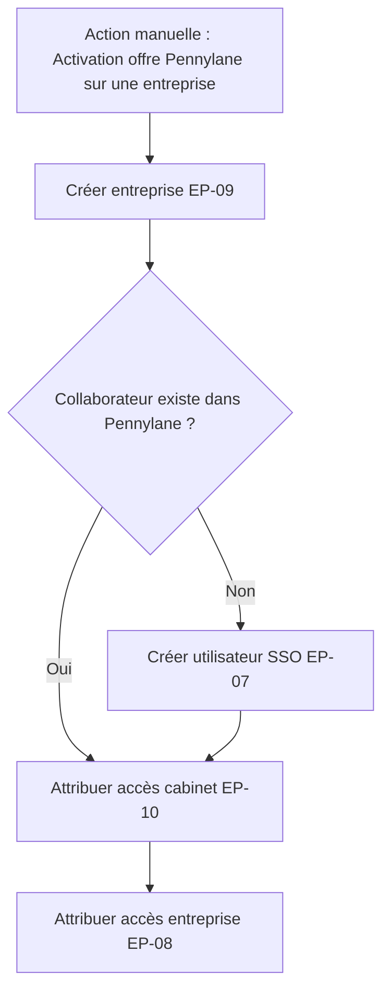
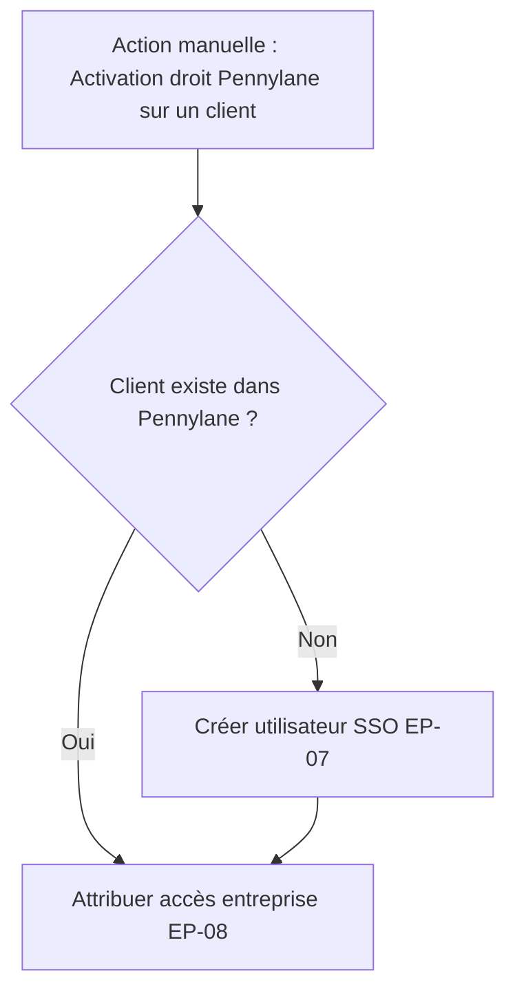
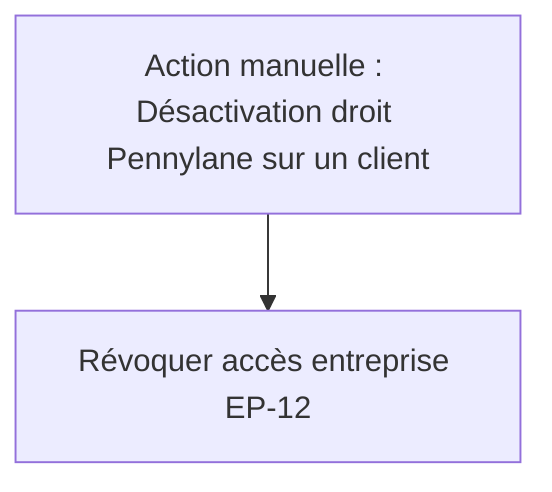
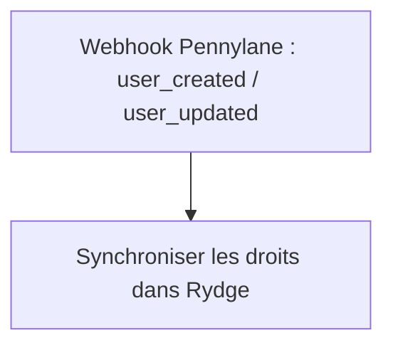
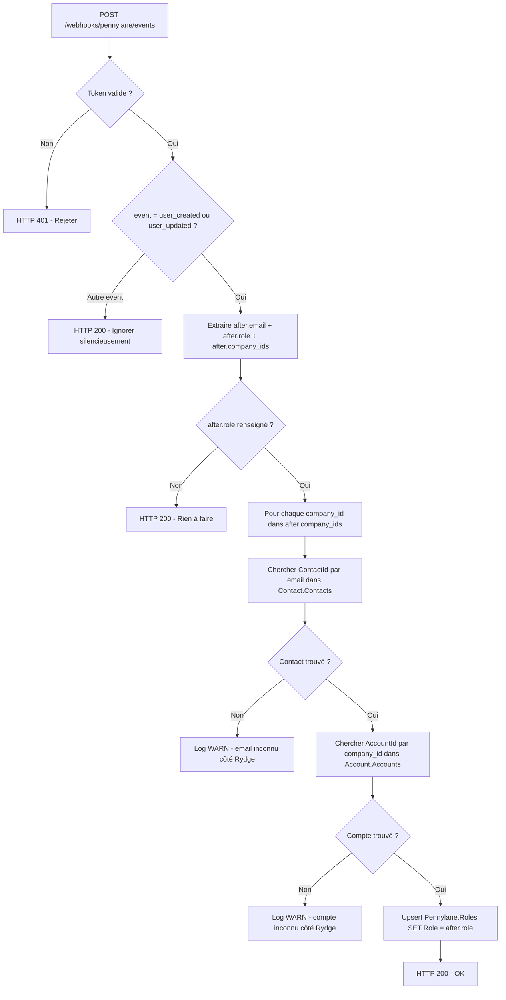

# Matrice d'Integration API Pennylane
  
**Projet** : Pulse.Back.Pennylane
**Systeme source** : Plateforme Rydge
**Systeme cible** : Plateforme Pennylane
**Direction des flux** : Rydge --> Pennylane (appels HTTPS sortants)
**Auteur** : Houssem DBIRA
**Date** : 04/02/2026
  
---
  
## 1. Contexte
  
Le systeme Plateforme Rydge communique avec la plateforme Pennylane via **deux API distinctes** :
  
| API | Base URL | Authentification | Perimetre | Documentation |
|-----|----------|------------------|-----------|---------------|
| **Group API** | https://app.pennylane.com/api/firm/v3 | Bearer token global | Gestion des utilisateurs, entreprises, cabinets, attribution/revocation d'acces | [Documentation Group API](https://pennylane-firm-group.readme.io/reference/introduction) |
| **Firm API** | https://app.pennylane.com/api/external/firm/v1 | Bearer token par cabinet | Gestion documentaire (DMS), resolution d'identifiants internes | [Documentation Firm API](https://firm-pennylane.readme.io/reference/company-dms-files) |
  
  
---

## 2. Flux d'intégration

### 2.1 Flux sortants (Rydge → Pennylane) - Actions manuelles

#### Activation d'une offre Pennylane sur une entreprise



#### Activation du droit Pennylane sur un client



#### Désactivation du droit Pennylane sur un client



### 2.2 Flux entrants (Pennylane → Rydge) - Webhooks



---

## 3. Tableau des endpoints
  
### 3.1 Group API (12 endpoints)

#### EP-01 : Lister les entreprises

| Propriete | Valeur |
|-----------|--------|
| **Methode** | GET |
| **Endpoint** | /companies |
| **Declencheur** | Consultation interne de la liste des entreprises |
| **Request** | Query : page (int) |
| **Response** | PennylaneCompanyPager |

#### EP-02 : Obtenir une entreprise

| Propriete | Valeur |
|-----------|--------|
| **Methode** | GET |
| **Endpoint** | /companies/{companyId} |
| **Declencheur** | Verification de l'existence d'une entreprise (attribution de role, onboarding, consultation emails) |
| **Request** | Path : companyId (string) |
| **Response** | PennylaneCompany |

#### EP-03 : Lister les utilisateurs d'une entreprise

| Propriete | Valeur |
|-----------|--------|
| **Methode** | GET |
| **Endpoint** | /companies/{companyId}/users |
| **Declencheur** | Lister les utilisateurs d'une entreprise (verification avant revocation d'acces, ou recherche d'un utilisateur specifique) |
| **Request** | Path : companyId - Query : page, perPage |
| **Response** | PennylaneUsersPager |

#### EP-04 : Lister tous les utilisateurs

| Propriete | Valeur |
|-----------|--------|
| **Methode** | GET |
| **Endpoint** | /users |
| **Declencheur** | Consultation interne de la liste globale des utilisateurs |
| **Request** | Query : page (int) |
| **Response** | PennylaneUsersPager |

#### EP-05 : Rechercher un utilisateur par email

| Propriete | Valeur |
|-----------|--------|
| **Methode** | GET |
| **Endpoint** | /users?filter=[...] |
| **Declencheur** | Verification de l'existence d'un utilisateur (ajout d'acces, attribution de role, onboarding) |
| **Request** | Query : filter (JSON email) |
| **Response** | PennylaneUsersPager |

#### EP-06 : Lister les cabinets

| Propriete | Valeur |
|-----------|--------|
| **Methode** | GET |
| **Endpoint** | /firms |
| **Declencheur** | Recuperation des firms |
| **Request** | Query : page, per_page |
| **Response** | PennylaneFirmsPager |

#### EP-07 : Creer un utilisateur (SSO)

| Propriete | Valeur |
|-----------|--------|
| **Methode** | POST |
| **Endpoint** | /users |
| **Declencheur** | Creation d'un compte utilisateur Pennylane en SSO uniquement. Declencheurs : (1) Activation du droit Pennylane sur un client qui n'a pas encore de compte Pennylane (2) Activation d'une offre Pennylane avec des collaborateurs inexistants dans Pennylane (le compte est cree avant l'attribution d'acces EP-08) |
| **Request** | Body : PennylaneContact |
| **Response** | PennylaneResult\<string\> |

#### EP-08 : Attribuer un acces entreprise

| Propriete | Valeur |
|-----------|--------|
| **Methode** | POST |
| **Endpoint** | /companies/{companyId}/grant_access |
| **Declencheur** | Attribution d'acces entreprise. Declencheurs : (1) Le droit Pennylane a ete active sur un utilisateur client (2) Activation d'une offre Pennylane avec des collaborateurs inexistants dans Pennylane |
| **Request** | Path : companyId - Body : GrantUserAccess |
| **Response** | PennylaneResult\<int\> |

#### EP-09 : Creer une entreprise

| Propriete | Valeur |
|-----------|--------|
| **Methode** | POST |
| **Endpoint** | /companies |
| **Declencheur** | Creation d'une nouvelle entreprise lors de l'activation d'une offre Pennylane par un collaborateur |
| **Request** | Body : CreatePennylaneCompanyRequest |
| **Response** | CreatePennylaneCompanyResponse |

#### EP-10 : Attribuer un acces cabinet

| Propriete | Valeur |
|-----------|--------|
| **Methode** | POST |
| **Endpoint** | /firms/{firmId}/grant_access |
| **Declencheur** | Attribution d'acces au cabinet pour un collaborateur afin qu'il puisse acceder aux entreprises du cabinet |
| **Request** | Path : firmId - Body : GrantUserAccess |
| **Response** | HTTP status uniquement |

> **Note :** Un code HTTP 422 avec le message "a deja acces a ce cabinet" est traite comme un succes.

#### EP-11 : Mettre a jour l'email d'un utilisateur

| Propriete | Valeur |
|-----------|--------|
| **Methode** | PUT |
| **Endpoint** | /users/{userId} |
| **Declencheur** | Mise a jour de l'email d'un utilisateur Pennylane. Declenche uniquement lors d'un changement d'email dans Akuiteo |
| **Request** | Path : userId - Body : { email } |
| **Response** | PennylaneResult\<string\> |

#### EP-12 : Revoquer un acces entreprise

| Propriete | Valeur |
|-----------|--------|
| **Methode** | DELETE |
| **Endpoint** | /companies/{companyId}/revoke_access |
| **Declencheur** | Revocation d'acces d'un utilisateur a une entreprise. Declenche lorsque le droit Pennylane est desactive dans la plateforme Rydge par le contact lui-meme, un autre collaborateur ou un administrateur |
| **Request** | Path : companyId - Query : user_id |
| **Response** | void |

---

### 3.2 Firm API (3 endpoints)

#### EP-13 : Lister les fichiers DMS

| Propriete | Valeur |
|-----------|--------|
| **Methode** | GET |
| **Endpoint** | /companies/{id}/dms/files |
| **Declencheur** | Synchronisation des documents (planifiee ou lors de la consultation par un client) |
| **Request** | Path : companyId (int) - Query : limit, cursor |
| **Response** | PennylaneDmsFilesResponse |

> **Note :** Pagination par curseur : les appels se repetent tant que has_more = true.

#### EP-14 : Recuperer un fichier DMS specifique

| Propriete | Valeur |
|-----------|--------|
| **Methode** | GET |
| **Endpoint** | /companies/{id}/dms/files?filter=[...] |
| **Declencheur** | Recuperation d'un document precis lors de la synchronisation |
| **Request** | Path : companyId (int) - Query : filter (JSON id) |
| **Response** | PennylaneDmsFilesResponse |

#### EP-15 : Lister les entreprises (Firm API)

| Propriete | Valeur |
|-----------|--------|
| **Methode** | GET |
| **Endpoint** | /companies |
| **Declencheur** | Resolution de l'identifiant interne Pennylane avant synchronisation documentaire |
| **Request** | Query : per_page (1000), page |
| **Response** | PennylaneCompanyFirmPager |

> **Note :** Parcourt toutes les pages jusqu'a trouver le client_code correspondant.

---

### 3.3 Document Stream (1 endpoint)

#### EP-16 : Telecharger un document

| Propriete | Valeur |
|-----------|--------|
| **Methode** | GET |
| **Endpoint** | URL complete (depuis PennylaneDmsFile.url) |
| **Declencheur** | Telechargement d'un document par un client depuis l'interface |
| **Request** | URL complete (string) |
| **Response** | Stream (binaire) |
  
---

## 3.4 Scénarios d'intégration

### Scénario 4 — Synchronisation continue des rôles

#### Contexte

Après le rattrapage one-shot (#60787), les rôles stockés dans `Pennylane.Roles` peuvent dériver
si un collaborateur Pennylane modifie le `sub_role` d'un utilisateur directement dans l'interface Pennylane.
Ce scénario décrit la **synchronisation périodique** (job Hangfire) qui maintient la cohérence.

#### Déclencheur

Job planifié (ex : toutes les nuits) — ou **à la demande** via un endpoint d'administration.

#### Flux

```mermaid
flowchart TD
    A[Job Hangfire : SyncRolesJob] --> B[Lire ContactAuthorization WHERE AuthorizationId=15]
    B --> C[Grouper par AccountNumber]
    C --> D[Pour chaque compte : EP-03 GET /companies/{id}/users]
    D --> E{Réponse OK ?}
    E -->|HTTP 404| F[Skip - compte absent de Pennylane]
    E -->|Erreur réseau| G[Log + retry backoff]
    E -->|200 OK| H[Parcourir les utilisateurs de la page]
    H --> I{Email dans ContactAuthorization ?}
    I -->|Non| J[Skip - email inconnu côté Rydge]
    I -->|Oui| K[Upsert Pennylane.Roles SET Role = sub_role]
    K --> L{Autre page ?}
    L -->|Oui| D
    L -->|Non| M[Checkpoint sauvegardé]
```

#### Règles métier

| Règle | Détail |
|---|---|
| Source de vérité | Pennylane est source de vérité pour le champ `role` |
| Champ synchronisé | `role` dans la réponse EP-03 → colonne `Role` dans `Pennylane.Roles` |
| Contact non trouvé | Si l'email Pennylane n'existe pas dans `Contact.Contacts` → ignorer silencieusement |
| Compte absent | HTTP 404 → skip sans erreur (compte test/REC probablement) |
| Upsert | `IF NOT EXISTS → INSERT ELSE UPDATE` — identique à la logique du script de rattrapage |
| Pagination | Boucle sur `total_pages` avec `per_page=500` |
| Idempotence | Le job peut être rejoué sans risque |

#### Endpoints utilisés

| Endpoint | Usage |
|---|---|
| EP-03 `GET /companies/{id}/users` | Récupérer les utilisateurs et leurs rôles par entreprise |

#### Impact base de données

```sql
-- Upsert unitaire produit par le job
IF NOT EXISTS (SELECT 1 FROM [Pennylane].[Roles] WHERE ContactId = @cid AND AccountId = @aid)
    INSERT INTO [Pennylane].[Roles] (ContactId, AccountId, Role) VALUES (@cid, @aid, @role);
ELSE
    UPDATE [Pennylane].[Roles] SET Role = @role WHERE ContactId = @cid AND AccountId = @aid;
```

---

### Scénario 5 — Gestion du webhook utilisateur

#### Contexte

Pennylane envoie un webhook `user_created` ou `user_updated` en **temps réel** à chaque
création ou modification d'un utilisateur sur la plateforme. Ce scénario permet de
**mettre à jour `Pennylane.Roles` immédiatement** sans attendre le job nuit.

#### Déclencheur

`POST /webhooks/pennylane/events?token={token}` — réception d'un payload Pennylane.

#### Flux



#### Payload reçu

```json
{
  "before": null,
  "after": {
    "id": "019bdbe6-5948-7847-bf71-568bcb61576c",
    "email": "exemple@domaine.com",
    "first_name": "test",
    "last_name": "test",
    "role": "customer",
    "phone_number": "",
    "assigned_to_firm": true,
    "company_ids": ["2025546345"],
    "sub_role": "executive"
  },
  "event": "user_created",
  "timestamp": 1768920865753
}
```

> ⚠️ **Attention** : Le champ `sub_role` dans le webhook correspond au champ `role`
> retourné par EP-03. C'est ce champ qui est persisté dans `Pennylane.Roles.Role`.

#### Règles métier

| Règle | Détail |
|---|---|
| Champ utilisé | `after.sub_role` → `Pennylane.Roles.Role` |
| Events traités | `user_created`, `user_updated` |
| Events ignorés | Tout autre type d'event → HTTP 200 sans traitement |
| `after` null | Si `after` est null (ex : suppression) → ignorer |
| `sub_role` vide | Si `after.sub_role` est null/vide → ignorer (rôle non défini) |
| `company_ids` vide | Si la liste est vide → rien à persister |
| Contact inconnu | Email absent de `Contact.Contacts` → log WARN, continuer |
| Compte inconnu | `company_id` absent de `Account.Accounts` → log WARN, continuer |
| Idempotence | Upsert idempotent : un webhook rejoué ne crée pas de doublon |
| Réponse | Toujours HTTP 200 pour éviter les renvois Pennylane (sauf token invalide) |

#### Valeurs valides pour `sub_role`

| Valeur | Libellé |
|---|---|
| `executive` | Dirigeant / Admin |
| `employee` | Employé |
| `internal_accountant` | Comptable interne |
| `invoicing_manager` | Gestionnaire de facturation |
| `purchasing_manager` | Gestionnaire facturation fournisseur |
| `sales_manager` | Gestionnaire facturation client |

#### Impact base de données

```sql
-- Résolution email → ContactId
SELECT ContactId FROM [Contact].[Contacts] WHERE Email = @email;

-- Résolution company_id (AccountNumber) → AccountId
SELECT AccountId FROM [Account].[Accounts] WHERE AccountNumber = @companyId;

-- Upsert
IF NOT EXISTS (SELECT 1 FROM [Pennylane].[Roles] WHERE ContactId = @cid AND AccountId = @aid)
    INSERT INTO [Pennylane].[Roles] (ContactId, AccountId, Role) VALUES (@cid, @aid, @subRole);
ELSE
    UPDATE [Pennylane].[Roles] SET Role = @subRole WHERE ContactId = @cid AND AccountId = @aid;
```

#### Complémentarité Scénario 4 / Scénario 5

| | Scénario 4 (job nuit) | Scénario 5 (webhook) |
|---|---|---|
| **Latence** | ~24h | Temps réel (<1s) |
| **Couverture** | Tous les comptes (33K+) | Uniquement l'utilisateur modifié |
| **Fiabilité** | Haute (traitement exhaustif) | Dépend de la livraison webhook Pennylane |
| **Rôle** | Filet de sécurité / rattrapage | Mise à jour immédiate |

> Les deux mécanismes sont **complémentaires** : le webhook assure la réactivité,
> le job nuit garantit la cohérence complète même si un webhook est perdu.

---
  
## 4. Flux entrants (Webhooks)

Le systeme Plateforme Rydge est connecte aux **webhooks Pennylane** et recoit des notifications pour les evenements suivants :

| Evenement | Description |
|---|---|
| user_created | Un utilisateur a ete cree dans Pennylane |
| user_updated | Un utilisateur a ete modifie dans Pennylane |

**Endpoint de reception :** POST /webhooks/pennylane/events?token={token}

Le token est valide cote Plateforme Rydge avant tout traitement.

### Exemple de payload recu

```json
{
  "before": null,
  "after": {
    "id": "019bdbe6-5948-7847-bf71-568bcb61576c",
    "email": "exemple@domaine.com",
    "first_name": "test",
    "last_name": "test",
    "role": "customer",
    "phone_number": "",
    "assigned_to_firm": true,
    "company_ids": [
      "2025546345"
    ],
    "sub_role": "executive"
  },
  "event": "user_created",
  "timestamp": 1768920865753
}
```

### Structure du payload

| Champ | Type | Description |
|---|---|---|
| before | User (nullable) | Etat de l'utilisateur avant l'evenement (null si creation) |
| after | User (nullable) | Etat de l'utilisateur apres l'evenement (null si suppression) |
| event | string | Type d'evenement (user_created, user_updated) |
| timestamp | long | Horodatage de l'evenement (epoch milliseconds) |

### Structure de l'objet User

| Champ | Type | Description |
|---|---|---|
| id | string | Identifiant unique de l'utilisateur |
| email | string | Adresse email |
| first_name | string | Prenom |
| last_name | string | Nom |
| role | string | Role (ex: customer) |
| phone_number | string | Numero de telephone |
| assigned_to_firm | bool | Assigne a un cabinet |
| company_ids | string[] | Liste des identifiants d'entreprises associees |
| sub_role | string | Sous-role (ex: executive) |

---

## 5. Modeles de donnees
  
### 5.1 Request DTOs
  
#### `CreatePennylaneCompanyRequest`
  
Utilise par : EP-09
  
| Champ JSON | Propriete C# | Type | Obligatoire | Description |
|------------|-------------|------|-------------|-------------|
| `country_alpha2` | CountryAlpha2 | string | Oui | Code pays ISO 3166-1 alpha-2 (defaut: "FR") |
| `firm_id` | FirmId | string | Oui | Identifiant du cabinet dans Pennylane |
| `name` | Name | string | Oui | Nom de l'entreprise |
| `reg_no` | RegNo | string? | Non | Numero SIREN (9 chiffres pour les entreprises francaises) |
| `id` | Id | string | Oui | Code client (numero de compte) - lien avec le DMS et les roles |
| `accounting_manager_id` | AccountingManagerId | string? | Non | ID Pennylane du responsable comptable |
| `accounting_supervisor_id` | AccountingSupervisorId | string? | Non | ID Pennylane du superviseur comptable |
| `accountant_id` | AccountantId | string? | Non | ID Pennylane du comptable |
| `fiscal_regime` | FiscalRegime | string? | Non | Regime fiscal (ex: "fr_rsi", "fr_is", "fr_ir") |
| `not_yet_registered` | NotYetRegistered | bool | Oui | Entreprise pas encore immatriculee (defaut: true) |
| `accounting_type` | AccountingType | string? | Non | Type de comptabilite |
  
---
  
#### `PennylaneContact`
  
Utilise par : EP-07
  
| Champ JSON | Propriete C# | Type | Obligatoire | Description |
|------------|-------------|------|-------------|-------------|
| `id` | Id | string | Non | ID utilisateur (ignore a l'ecriture si null) |
| `first_name` | FirstName | string | Oui | Prenom |
| `last_name` | LastName | string | Oui | Nom |
| `email` | Email | string | Oui | Adresse email |
| `skip_welcome_email` | SkipWelcomeEmail | bool | Oui | Ne pas envoyer l'email de bienvenue |
| `authentication_method` | AuthenticationMethod | string | Oui | Methode d'authentification |
  
---
  
#### `GrantUserAccess`
  
Utilise par : EP-08, EP-10
  
| Champ JSON | Propriete C# | Type | Obligatoire | Description |
|------------|-------------|------|-------------|-------------|
| `role` | Role | string | Oui | Role a attribuer |
| `user_id` | UserId | string? | Conditionnel | ID utilisateur Pennylane (mode legacy, si `UseUserIdForGrantAccess` = true) |
| `user_email` | UserEmail | string? | Conditionnel | Email utilisateur (nouveau mode, si `UseUserIdForGrantAccess` = false) |
  
---
  
### 5.2 Response DTOs
  
#### `PennylaneCompany`
  
Retourne par : EP-01 (dans pager), EP-02
  
| Champ JSON | Propriete C# | Type | Description |
|------------|-------------|------|-------------|
| `id` | Id | string | Identifiant de l'entreprise (code client) |
| `firm_id` | FirmId | string | Identifiant du cabinet |
| `reg_no` | RegNo | string | Numero SIREN |
| `name` | Name | string | Nom de l'entreprise |
| `trade_name` | TradeName | string | Nom commercial |
| `address` | Address | string | Adresse |
| `city` | City | string | Ville |
| `postal_code` | PostalCode | string | Code postal |
| `country_alpha2` | CountryAlpha2 | string | Code pays |
| `saas_plan` | SaasPlan | string | Plan SaaS souscrit |
| `fiscal_category` | FiscalCategory | string | Categorie fiscale |
| `fiscal_regime` | FiscalRegime | string | Regime fiscal |
| `legal_form_code` | LegalFormCode | string | Code forme juridique |
| `vat_frequency` | VatFrequency | string | Frequence de TVA |
| `vat_day_of_month` | VatDayOfMonth | int? | Jour du mois pour la TVA |
| `tos_accepted_at` | TosAcceptedAt | DateTime? | Date d'acceptation des CGU |
| `supplier_invoice_transmission_emails` | SupplierInvoiceTransmissionEmails | string[]? | Emails de transmission factures fournisseurs |
| `customer_invoice_transmission_emails` | CustomerInvoiceTransmissionEmails | string[]? | Emails de transmission factures clients |
| `not_yet_registered` | NotYetRegistered | bool | Entreprise pas encore immatriculee |
  
---
  
#### `PennylaneUsers`
  
Retourne par : EP-03 (dans pager), EP-04 (dans pager), EP-05 (dans pager)
  
| Champ JSON | Propriete C# | Type | Description |
|------------|-------------|------|-------------|
| `id` | Id | string | Identifiant de l'utilisateur |
| `first_name` | FirstName | string | Prenom |
| `last_name` | LastName | string | Nom |
| `email` | Email | string | Adresse email |
| `blocked_at` | BlockedAt | object | Date de blocage (null si actif) |
| `role` | Role | string | Role de l'utilisateur |
  
---
  
#### `PennylaneDmsFile`
  
Retourne par : EP-13, EP-14 (dans `PennylaneDmsFilesResponse`)
  
| Champ JSON | Propriete C# | Type | Description |
|------------|-------------|------|-------------|
| `id` | Id | int | Identifiant du fichier |
| `name` | Name | string | Nom du fichier |
| `path` | Path | string | Chemin dans le DMS |
| `created_at` | CreatedAt | DateTime | Date de creation |
| `updated_at` | UpdatedAt | DateTime | Date de derniere modification |
| `url` | Url | string | URL de telechargement du fichier |
  
---
  
#### `PennylaneDmsFilesResponse`
  
Retourne par : EP-13, EP-14
  
| Champ JSON | Propriete C# | Type | Description |
|------------|-------------|------|-------------|
| `items` | Items | List\<PennylaneDmsFile\> | Liste des fichiers |
| `has_more` | HasMore | bool | Indique s'il reste des resultats |
| `next_cursor` | NextCursor | string? | Curseur pour la page suivante |
  
---
  
#### `PennylaneCompanyFirm`
  
Retourne par : EP-15 (dans `PennylaneCompanyFirmPager`)
  
| Champ JSON | Propriete C# | Type | Description |
|------------|-------------|------|-------------|
| `id` | Id | int | Identifiant interne Pennylane de l'entreprise |
| `client_code` | ClientCode | string | Code client (numero de compte) |
  
---
  
#### `PennylaneFirm`
  
Retourne par : EP-06 (dans `PennylaneFirmsPager`)
  
| Champ JSON | Propriete C# | Type | Description |
|------------|-------------|------|-------------|
| `id` | Id | string | Identifiant du cabinet |
| `name` | Name | string | Nom du cabinet |
| `reg_no` | RegNo | string? | Numero d'immatriculation |
  
---
  
#### `PennylaneResult<T>`
  
Retourne par : EP-07 (`T` = string), EP-08 (`T` = int), EP-11 (`T` = string)
  
| Champ JSON | Propriete C# | Type | Description |
|------------|-------------|------|-------------|
| `id` | Id | T | Identifiant du resultat (type generique) |
  
---
  
#### `CreatePennylaneCompanyResponse`
  
Retourne par : EP-09
  
| Champ JSON | Propriete C# | Type | Description |
|------------|-------------|------|-------------|
| `id` | Id | string | Identifiant de l'entreprise creee (code client) |
  
---
  
### 5.3 Pagination DTOs
  
#### `PennylanePaged` (classe de base)
  
| Champ JSON | Propriete C# | Type | Description |
|------------|-------------|------|-------------|
| `total_pages` | TotalPages | int | Nombre total de pages |
| `current_page` | CurrentPage | int | Page courante |
  
#### Pagers derives
  
| Pager | Propriete collection | Type element | Utilise par |
|-------|---------------------|--------------|-------------|
| `PennylaneCompanyPager` | `companies` | `PennylaneCompany` | EP-01 |
| `PennylaneUsersPager` | `users` | `PennylaneUsers` | EP-03, EP-04, EP-05 |
| `PennylaneFirmsPager` | `firms` | `PennylaneFirm` | EP-06 |
| `PennylaneCompanyFirmPager` | `items` | `PennylaneCompanyFirm` | EP-15 |